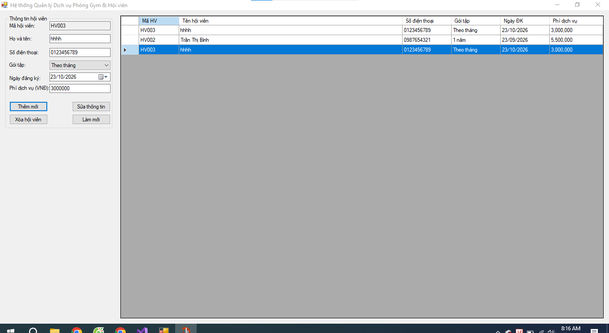
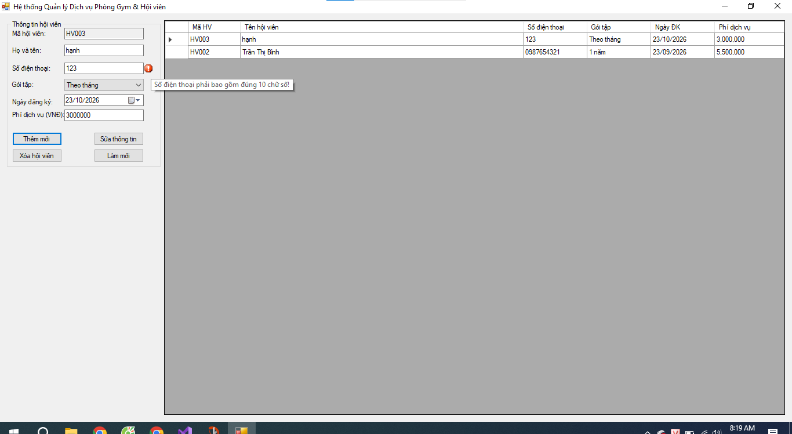
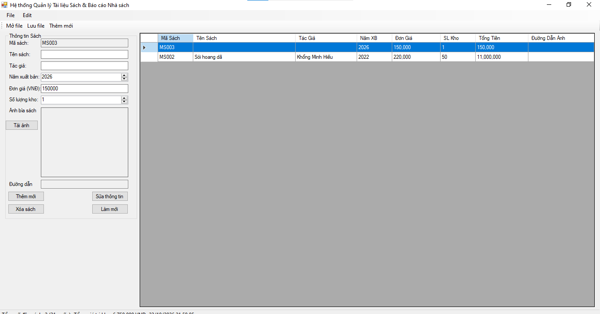
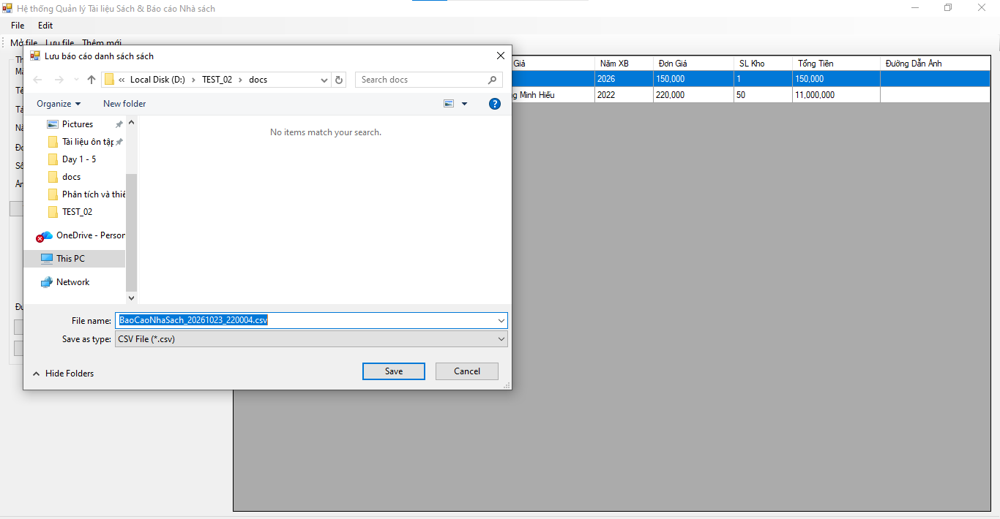
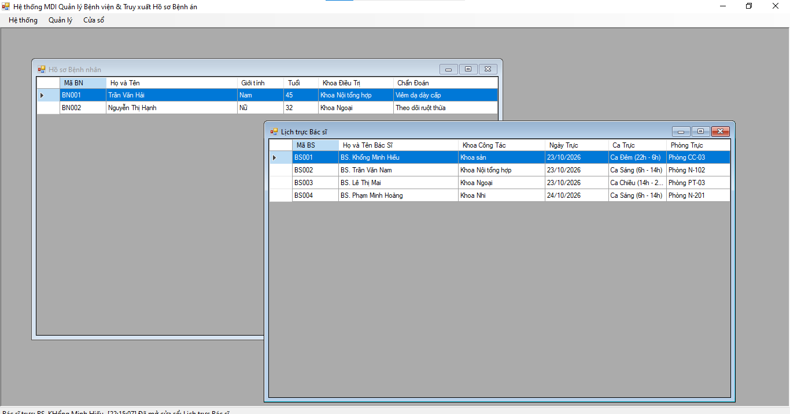
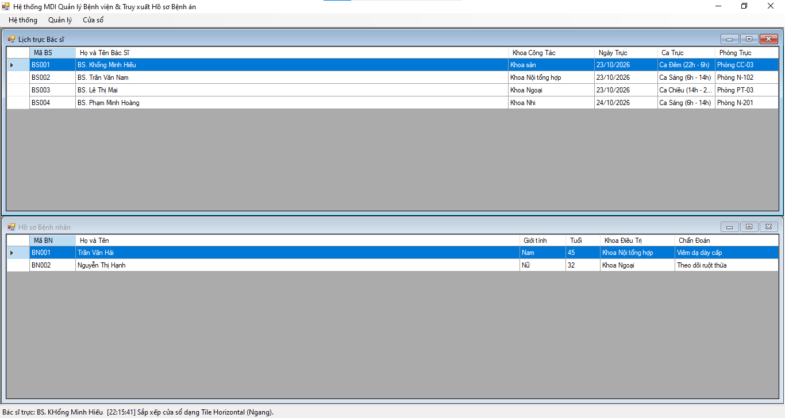
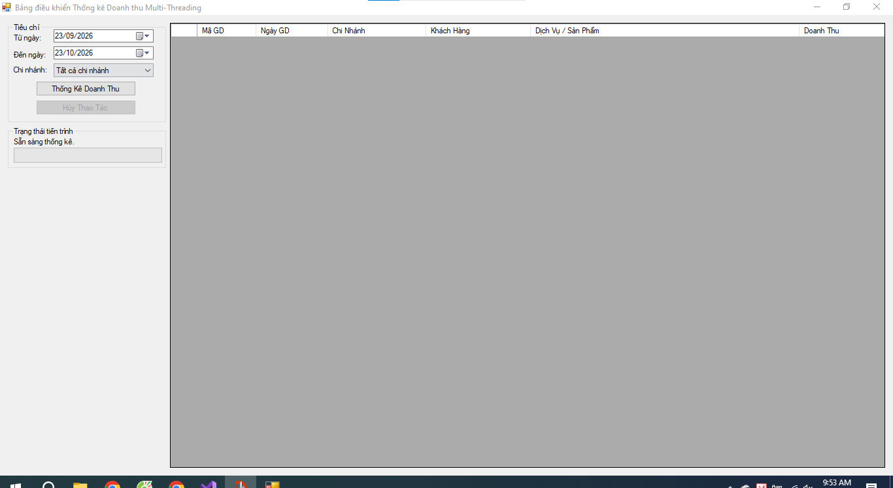
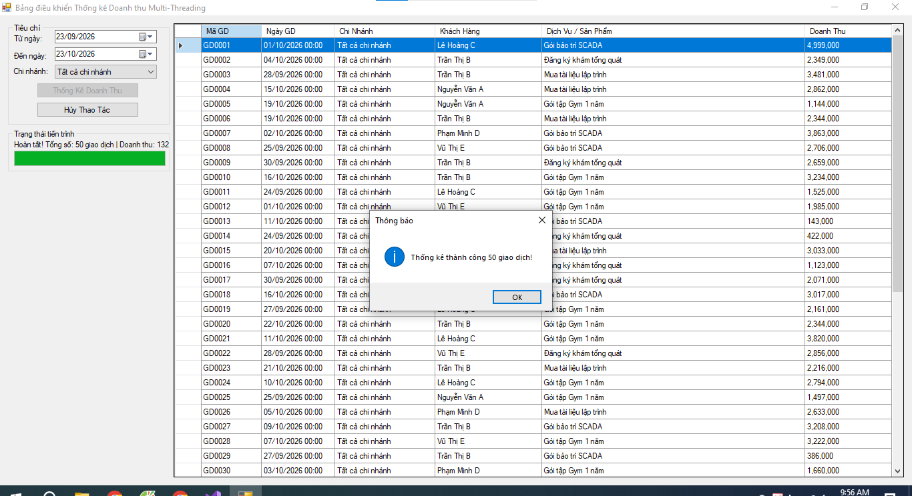
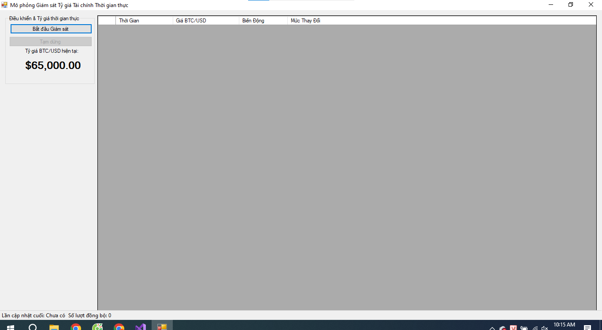

# BÁO CÁO BÀI TẬP TEST 02

## I. THÔNG TIN SINH VIÊN

- **Họ và tên:** Khổng Minh Hiếu
- **Mã số sinh viên:** 24810320250
- **Lớp học phần:** Lập trình .NET - Mã Lớp: D19QTANM1
- **Link Repository:** https://github.com/khongminhhieu1805/LTNET-TEST02_24810320250_KhongMinhHieu
---

## II. DANH SÁCH BÀI TẬP HOÀN THÀNH & TỰ ĐÁNH GIÁ

| Bài tập | Tiêu đề bài tập | Trạng thái | Mức độ hoàn thành (%) |
| :---: | :--- | :---: | :---: |
| **Bài 1** | Quản lý Dịch vụ Phòng Gym & Hội viên | Hoàn thành | 100% |
| **Bài 2** | Quản lý Tài liệu Sách & Xuất Báo cáo Nhà sách | Hoàn thành | 100% |
| **Bài 3** | Hệ thống MDI Quản lý Bệnh viện & Truy xuất Hồ sơ Bệnh án | Hoàn thành | 100% |
| **Bài 4** | Bảng Điều khiển Thống kê Doanh thu Multi-Threading | Hoàn thành | 100% |
| **Bài 5** | Mô phỏng Giám sát Tỷ giá Tài chính Thời gian thực | Hoàn thành | 100% |

---

## III. MINH HỌA GIAO DIỆN & KỸ THUẬT NỔI BẬT

### 1. Bài 1: Quản lý Dịch vụ Phòng Gym & Hội viên
- **Kỹ thuật áp dụng:**
  - Cấu hình `DataGridView` thuần code (`AutoGenerateColumns = false`, tùy chỉnh Header, căn chỉnh cột và định dạng số `N0`).
  - Cơ chế đồng bộ dữ liệu hai chiều (Data Binding) sử dụng `BindingList<T>` kết hợp `BindingSource`.
  - Triển khai `INotifyPropertyChanged` trên class Model giúp giao diện tự phản hồi thay đổi thuộc tính.
  - Kiểm tra tính toàn vẹn dữ liệu nhập liệu trực quan với `ErrorProvider` và Regex (Tên không chứa ký tự đặc biệt, SĐT đúng 10 chữ số, Phí nguyên dương).
- **Hình ảnh minh họa Giao diện:**


*Mô tả: Giao diện chính hiển thị DataGridView và đồng bộ dữ liệu 2 chiều lên các trường nhập liệu.*


*Mô tả: ErrorProvider cảnh báo lỗi trực quan khi dữ liệu không thỏa mãn điều kiện nghiệp vụ.*

---

### 2. Bài 2: Quản lý Tài liệu Sách & Xuất Báo cáo Nhà sách
- **Kỹ thuật áp dụng:**
  - Khai thác hộp thoại hệ thống: `OpenFileDialog` (Tải ảnh bìa sách dạng `.png`, `.jpg` và Import file CSV), `SaveFileDialog` (Xuất báo cáo định dạng CSV kèm UTF-8 BOM).
  - Tải ảnh an toàn không khóa file trên ổ đĩa bằng luồng bộ nhớ `MemoryStream` và hiển thị tỷ lệ chuẩn qua `PictureBoxSizeMode.Zoom`.
  - Thanh điều hướng chuyên nghiệp với `MenuStrip`, `ToolStrip` và `StatusStrip`.
  - Cơ chế tự động tính toán lại Tổng số đầu sách và Tổng giá trị kho thông qua sự kiện `ListChanged` của `BindingList<T>`.
- **Hình ảnh minh họa Giao diện:**


*Mô tả: Khu vực nhập liệu chi tiết kèm ảnh bìa sách và DataGridView hiển thị danh mục sách trong kho.*


*Mô tả: Thao tác xuất và nạp dữ liệu thông qua hộp thoại hệ thống SaveFileDialog/OpenFileDialog.*

---

### 3. Bài 3: Hệ thống MDI Quản lý Bệnh viện & Truy xuất Hồ sơ Bệnh án
- **Kỹ thuật áp dụng:**
  - Kiến trúc đa cửa sổ MDI chuẩn mực (`IsMdiContainer = true`).
  - Hàm generic `OpenMdiChild<T>()` kiểm tra danh sách `MdiChildren`, ngăn chặn mở lặp lại (duplicate form) và đưa form đã mở lên trên bằng `.Activate()`.
  - Tự động quản lý danh sách cửa sổ con bằng thuộc tính `MdiWindowListItem`.
  - Điều hướng và sắp xếp cửa sổ con linh hoạt: `Cascade` (Xếp tầng), `TileHorizontal` (Ngang), `TileVertical` (Dọc), `CloseAll` (Đóng tất cả).
- **Hình ảnh minh họa Giao diện:**


*Mô tả: Cửa sổ cha MDI điều khiển và quản lý đồng thời hai Form con Hồ sơ bệnh nhân và Lịch trực bác sĩ.*


*Mô tả: Sắp xếp các cửa sổ con theo dạng Tile Horizontal/Vertical hoặc Cascade từ menu Cửa sổ.*

---

### 4. Bài 4: Bảng Điều khiển Thống kê Doanh thu Multi-Threading (Async/Await & Cancellation)
- **Kỹ thuật áp dụng:** Lập trình bất đồng bộ `async/await` kết hợp `Task.Run()` đẩy tác vụ nặng 5 giây xuống Background Thread giữ UI mượt mà, sử dụng `Progress<int>` cập nhật ProgressBar và `CancellationTokenSource` hủy tác vụ an toàn.

*Mô tả: Giao diện Bài 4.*

*Mô tả: Kết quả Bài 4*
---

### 5. Bài 5: Mô phỏng Giám sát Tỷ giá Tài chính Thời gian thực
- **Kỹ thuật áp dụng:**
  - Vòng lặp chạy ngầm định kỳ (Background Loop) khởi chạy bằng `Task.Run`, cập nhật biến động tỷ giá BTC/USD mỗi 2 giây.
  - Tuân thủ nguyên tắc Cross-Thread Safety trong Windows Forms bằng cách kiểm tra `this.InvokeRequired` và điều phối về UI Thread qua `this.Invoke(new Action(...))`.
  - Đảm bảo tuyệt đối không phát sinh ngoại lệ `InvalidOperationException: Cross-thread operation not valid` khi chạy chế độ Debug.
  - Cập nhật trực quan giao diện thời gian thực: đổi màu chữ số (Xanh khi tăng, Đỏ khi giảm), tự động ghi nhận nhật ký vào `dgvHistoryLog` và đếm lượt đồng bộ trên `StatusStrip`.
- **Hình ảnh minh họa Giao diện:**


*Mô tả: Bảng điện tử tỷ giá tự đổi màu theo xu hướng thị trường và bảng nhật ký lịch sử quét biến động.*

---

## IV. HƯỚNG DẪN CÀI ĐẶT & CHẠY DỰ ÁN

1. **Clone Repository về máy:**
   ```bash
   git clone https://github.com/khongminhhieu1805/LTNET-TEST02_24810320250_KhongMinhHieu
   ```

2. **Mở Solution:**
   - Khởi động **Visual Studio 2019** (hoặc phiên bản tương đương hỗ trợ .NET Framework / .NET Core Desktop).
   - Mở file solution: `src/WinFormsAppSolution.sln` (hoặc mở từng Project `Bai1`, `Bai2`, `Bai3`, `Bai4`, `Bai5`).

3. **Chọn Project khởi động (Startup Project):**
   - Nhấp chuột phải vào Project muốn chấm (ví dụ: `Bai1` hoặc `Bai4`) trong **Solution Explorer**.
   - Chọn **Set as Startup Project**.

4. **Biên dịch & Khởi chạy:**
   - Nhấn **Ctrl + Shift + B** để Build Solution.
   - Nhấn **F5** (hoặc chọn nút **Start**) để khởi chạy và kiểm thử chương trình.
